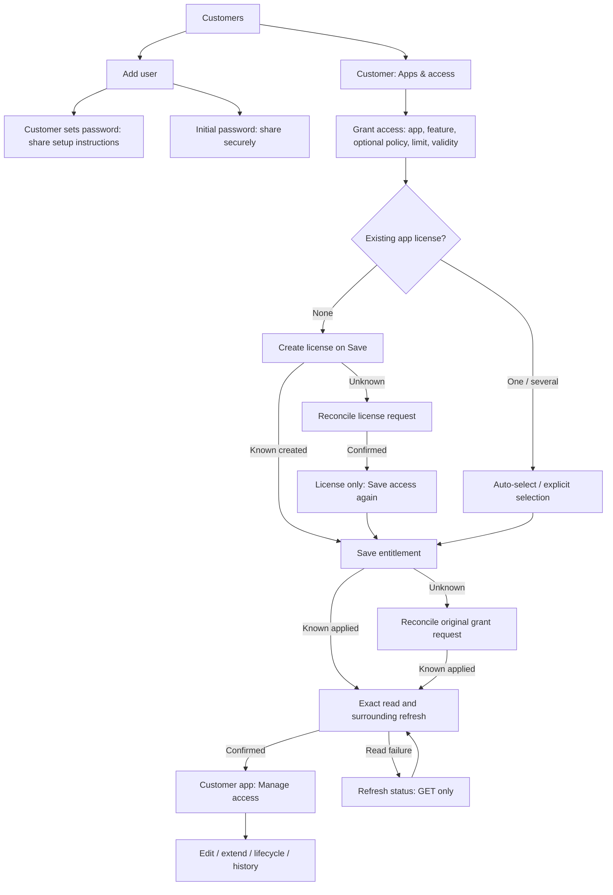
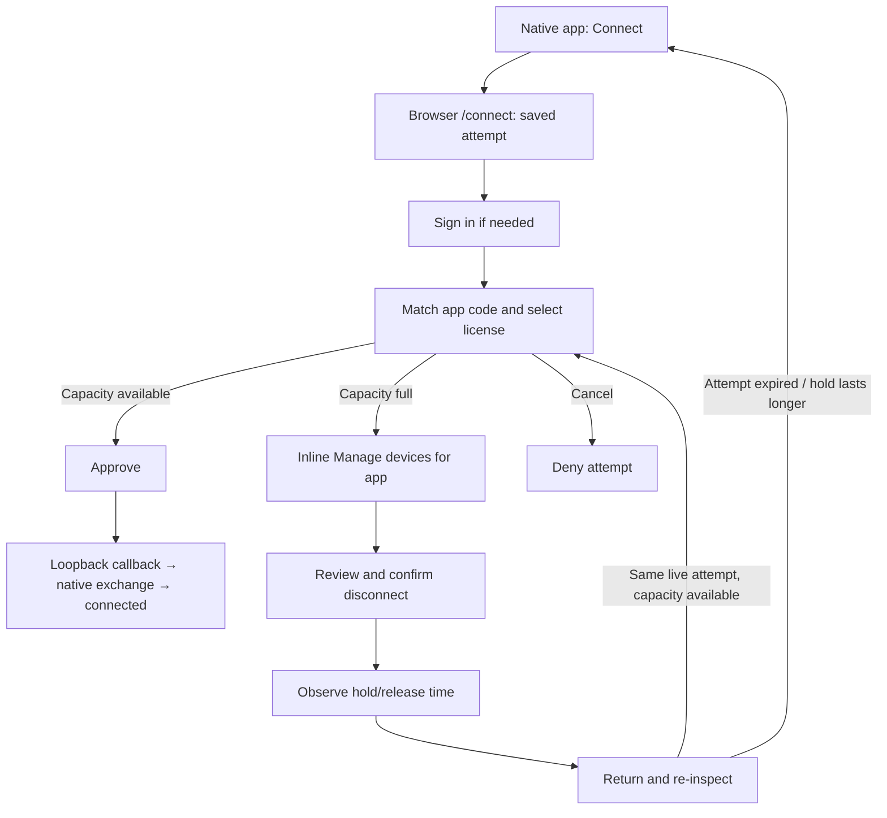

# Current UI workflows and problems

Five problems are confirmed in the current UI: two correctness issues and three presentation gaps.
Fix the account-context and grant-confirmation issues first. The maps below describe the existing
product, including its recovery paths, rather than the deferred larger redesign.

Reviewed ref: `4438e323327345acc1aac1743d610673d7596085`, branch
`fix/ui-ux-gap-closure-20261025`. Application code is the verified implementation at
`b81ec72731ffc89ccea6746669985fae6d34b334`. This review changes only documentation and local audit
evidence; all findings below remain open.

## Findings in priority order

### Portal disconnect can act on another signed-in account

Severity: P2, medium. Confidence: high. Category: workflow correctness.

If another tab changes the session from account A to B, the Account screen can continue to say
Signed in as A. Confirming Disconnect Google then removes B's Google identity. The UI sends only
the provider, and the Worker uses the current cookie without a displayed-account precondition.

Verbatim evidence:

- [AccountFeature.tsx:41](../../services/cloudflare-customer-portal/src/ui/features/account/AccountFeature.tsx#L41): `JSON.stringify({ provider })`
- [OAuth route:114](../../services/cloudflare-customer-portal/src/worker/routes/oauth.ts#L114): `const session = await authSession(request, env, reqId, now);`

The desktop and mobile reproduction used the actual compiled Worker, an in-memory SQLite database,
and minted fixture sessions. After switching the cookie to B, the browser still displayed A; the
unlink returned 200, A kept Google and GitHub, and B kept only GitHub. The reproduction uses a valid
authenticated B session, and the existing last-sign-in-method protection still applies.

Improvement: send the displayed customer as a precondition and compare it with the authenticated
session before unlinking, following the existing device-operation pattern. On mismatch, refresh
identity and require the user to confirm in the correct account context. Keep cookie authentication
as authority. Review other account mutations for the same pattern without assuming they are proven.

Validation: render A, switch to B's cookie, confirm unlink, and require account-change recovery with
zero identity deletes. Cover same-account success and the last-sign-in-method guard as controls.

Proof: [mobile stale-account result](../../build/workflow-review-20261025-4438e323/stale-account-unlink-390.png).

### A changed grant status leaves confirmation stuck

Severity: P2, medium. Confidence: high. Category: workflow correctness.

A known successful grant POST can be followed by a legitimate suspension or revocation before its
confirmation GET. The exact read rejects the correctly identified record because its status differs
from the write response. Repeated Refresh status reads return the current owned record, but the
draft remains locked and the notice never settles. Reloading reveals the suspended grant normally.

Verbatim evidence:

- [useEntitlementCreate.ts:86](../../services/cloudflare-license-admin/src/ui/features/entitlements/useEntitlementCreate.ts#L86): `row.status===target.status`
- The visible recovery remains: `The change was applied, but its status could not be refreshed.`

The reproduction returns a successful active grant, then a valid suspended version of that same
ID, owner, project, feature, fingerprint, and license. Three exact reads and one original POST leave
Refresh status visible at both widths. A fresh document can open the current suspended grant.

Improvement: distinguish confirmation of the known write from the record's subsequent lifecycle.
Keep strict identity/ownership validation, accept a valid current lifecycle state for the same record,
and show that latest state or an explicit concurrent-change result. Recovery must remain GET-only.

Validation: active-to-suspended and active-to-revoked changes settle to the current record without
another POST. Wrong identity, wrong owner, malformed data, and unavailable reads retain recovery.

Proof: [mobile locked confirmation](../../build/workflow-review-20261025-4438e323/changed-grant-status-390.png).

### Password reset promises a sign-in that does not happen

Severity: P3, low. Confidence: high. Category: usability and copy.

The shared password-completion screen handles registration and password reset. Its button always
promises sign-in, but a reset deliberately finishes with another sign-in step. This also affects
the admin-created customer's first-password journey, which uses reset.

Verbatim evidence:

- [PasswordAction.tsx:49](../../services/cloudflare-customer-portal/src/ui/features/auth/PasswordAction.tsx#L49): `Save password and sign in`
- [PasswordAction.tsx:36](../../services/cloudflare-customer-portal/src/ui/features/auth/PasswordAction.tsx#L36): `Password saved. Sign in with your new password.`

Both widths show the promised action followed by the request to sign in again. Registration and
reset have distinct successful results; their session behavior should stay explicit.

Improvement: use the neutral Save password action and describe the next step after the response.
Keep registration's authenticated result and reset's required sign-in behavior.

Validation: reset never promises an automatic sign-in; registration still reaches Apps after its
authenticated completion. Check the admin-created first-password journey too.

Proof: [reset action](../../build/workflow-review-20261025-4438e323/reset-action-label-390.png) and
[reset result](../../build/workflow-review-20261025-4438e323/reset-requires-signin-390.png).

### Guided grants lose readable customer context

Severity: P3, low. Confidence: high. Category: usability and information hierarchy.

The customer workspace shows the person's name and email, but Grant access moves to a generic
License access page whose customer summary contains only the internal ID. The operator must retain
the context mentally or go back to verify who will receive access. The backend still validates the ID.

Verbatim evidence:

- [GuidedGrantFields.tsx:47](../../services/cloudflare-license-admin/src/ui/features/entitlements/GuidedGrantFields.tsx#L47): `Customer: {form.customer_id}`

The reproduction starts from Alex Workflow with a readable email. Neither appears anywhere in the
visible grant screen at 1440px or 390px; the ID remains visible.

Improvement: carry a readonly customer name/email summary into the guided screen alongside the
immutable ID. Keep private context out of URLs and preserve the ID as the mutation precondition.

Validation: customer name, relevant email, and ID remain visible through review and partial recovery;
switching customers updates all three and never leaks private fields into navigation URLs.

Proof: [mobile grant context](../../build/workflow-review-20261025-4438e323/grant-customer-context-390.png).

### Suspension actions use inconsistent terminology

Severity: P3, low. Confidence: high. Category: usability and vocabulary consistency.

The status badge says Suspended, while the matching customer and grant actions say Disable and
Reenable. This adds a translation step between the action and its outcome. The current design uses
suspend/resume language and the maintained glossary names the status suspended.

Verbatim evidence:

- [EntitlementList.tsx:81](../../services/cloudflare-license-admin/src/ui/features/entitlements/EntitlementList.tsx#L81): `>Disable</button>`
- [EntitlementList.tsx:82](../../services/cloudflare-license-admin/src/ui/features/entitlements/EntitlementList.tsx#L82): `>Reenable</button>`
- [Customers.tsx:293](../../services/cloudflare-license-admin/src/ui/features/customers/Customers.tsx#L293) uses the same Disable action.

Improvement: use Suspend and Resume consistently for customer and access lifecycle actions and
their confirmation copy. Preserve the existing wire codes, handlers, reason requirements, and
irreversible Revoke behavior. Keep webhook configuration terminology scoped to its own resource.

Validation: active customer/access actions say Suspend; suspended records say Resume; the existing
mutation bodies and confirmation protections continue to pass their tests.

Proof: [suspended record and Reenable action](../../build/workflow-review-20261025-4438e323/lifecycle-terms-390.png).

## Current operator UI

The admin shell is protected by the deployment's access layer. Its current navigation is:

| Group | Screens | Main purpose |
| --- | --- | --- |
| Daily work | Overview, Customers, License access | Find a customer, review account/access, and create or maintain grants. |
| Configuration | Policies, Plans & features, Webhooks | Reusable rules, catalog composition/import, event endpoints and deliveries. |
| Activity | Events, Order activity, Reports | Audit history, incoming order/subscription processing, usage and expiry views. |
| Related records | Issued licenses | License-record lookup and links to the customer and related entitlements. |

Sources: [shell labels](../../services/cloudflare-license-admin/src/ui/app/shellContent.ts),
[navigation groups](../../services/cloudflare-license-admin/src/ui/app/Sidebar.tsx), and
[application composition](../../services/cloudflare-license-admin/src/ui/app/App.tsx).

### Account setup and ordinary access

Creating a customer grants no access. Customer sets password sends no invitation email; its setup
instructions are shared manually. The initial-password alternative is explicit. The guided access
form preserves its generated fingerprint and locks its draft during saving and confirmation.

Recovery has separate meanings:

| State | Current path |
| --- | --- |
| License write uncertain | Reconcile the same license request. After license-only success, Access not granted remains and Save access finishes the grant. |
| Entitlement write uncertain | Reconcile the original body and idempotency key, then confirm through reads. |
| Write known successful, read unavailable | Refresh status issues GETs. The changed-status exception above currently gets stuck here. |
| Conclusive refusal | Keep the draft and any already-created license; fix the cause and save again. |
| Cancel or policy detour | Navigation guards protect a dirty draft; a policy detour retains its context. Cancel preserves an already-created license record. |

### Maintenance and configuration

| Task | Current workflow |
| --- | --- |
| Maintain one customer's access | Customer → app → Manage access → contextual details → Edit, Extend validity, or lifecycle action. Reasons/typed confirmation protect consequential actions. |
| Inspect devices | Customer → Connected devices → app/connection → disconnect confirmation → retiring hold/release status. |
| Advanced record work | License access → filtered list → New entitlement / Edit / lifecycle / History. Manual relationships and full fingerprint are available here. |
| Reusable policy | Policies → create/edit rules → choose in a grant or catalog plan-feature. Grant creation can open a policy detour and return to its draft. |
| Catalog | Plans & features → Plans or Features → create/edit → configure plan features and optional policies. |
| Apply a plan | Plan → Apply plan → owner/license context and options → Preview → review changes → confirmed Apply. |
| Catalog import | Import → paste catalog → Preview import → review → Apply import. |
| Webhooks | Endpoint list → create/edit → event selection → save; inspect deliveries, send a test event, or retry a delivery. |
| Activity | Events filters/history; Order activity filters incoming processing events by subscription/status; Reports offers usage, refusals, and expiring-access drill-downs. |
| Related records | Issued licenses → search by ID/label, customer, or project → Open customer or View entitlements. |

Policy/catalog setup assists ordinary grants and is optional when valid manual identifiers are used.
Order activity is a processing-history view; this UI does not implement a checkout journey.

## Current customer UI

The authenticated navigation contains Apps, Devices, and Account. Licenses are inside each app's
detail screen. Password completion and native connection requests temporarily take precedence over
the ordinary shell.

| Entry/task | Current workflow |
| --- | --- |
| Sign in | Password, email code, or configured Google/GitHub provider → authenticated destination. A pending native request resumes into consent. |
| Register | Create an account → verify email link → choose password → authenticated portal. |
| Set/reset password | Request link → verify email link → choose password → Back to sign in → authenticate. The action-label mismatch is listed above. |
| Review access | Apps → app → license/feature cards → status, validity/trial, device limit, technical details. |
| Manage devices | Devices, or app → View devices → optional app filter/search → owned connection → review/confirm disconnect → release-time status. Sparse searches can require Continue search. |
| Account | Connected sign-in providers → connect or confirm disconnect; password set/change where enabled; Account ID in details. Provider linking can require a recent sign-in. |

Sources: [portal shell](../../services/cloudflare-customer-portal/src/ui/app/App.tsx),
[app details](../../services/cloudflare-customer-portal/src/ui/features/apps/AppsFeature.tsx),
[device view](../../services/cloudflare-customer-portal/src/ui/features/devices/DevicesFeature.tsx), and
[account view](../../services/cloudflare-customer-portal/src/ui/features/account/AccountFeature.tsx).

### Native connection and capacity recovery

App device management can show connections belonging to different licenses of that app; its copy
makes that scope explicit. Disconnect stops further issuance, while existing signed leases can
retain capacity until their acceptance hold ends. A connection request may expire first, requiring
a new Connect attempt from the native app.

## Complexity to keep and complexity to remove

| Keep the protection | Simplify its presentation |
| --- | --- |
| Comparison-code matching and server ownership checks | Carry readable customer/account context through every confirmation. |
| Immutable retries and GET-only recovery after known success | Settle correctly when a later valid state supersedes the original result. |
| Capacity holds and explicit request expiry | Continue showing release time and the required restart point. |
| Reasons and typed confirmation for irreversible changes | Use one vocabulary for status and lifecycle actions. |
| Advanced record tools and optional catalog/policy workflows | Make the customer-centered guided path easy to identify; keep internal IDs secondary. |

Manual invitation sharing and the larger October 1 redesign are explicitly deferred by the
[current design](../superpowers/specs/2026-10-25-ui-ux-gap-closure-design.md). They are product scope
decisions, rather than new defects inferred by this review. No manipulative mechanism was identified
in the inspected consent, setup, or provider-disconnect flows.

## Coverage and verification

The review covered all admin navigation areas and the portal's auth, Apps, Devices, Account, and
connection paths. Browser/Worker reproductions concentrate on the five findings, not every role and
production integration.
No anti-pattern was inferred from file size alone or from the presence of necessary safety guards.

| Surface | Evidence |
| --- | --- |
| Account-context mutation | Fresh browser plus actual compiled Worker, minted A/B sessions, and real in-memory SQLite. |
| Grant recovery and customer context | Fresh browser with controlled admin responses representing a successful write and a later valid lifecycle change. |
| Reset wording and lifecycle labels | Source, existing journey tests, and fresh desktop/mobile rendered states. |
| Visual foundation | Shared-token parity check passes; inspected mobile captures show the reported states. |
| Architecture | Ownership and module boundaries reviewed; architecture/hotspot checks are recorded below. |

Fresh commands for this audit:

- `node --experimental-sqlite build/workflow-review-20261025-4438e323/review-proof.mjs`: passed, reproducing ten observations at 1440px and 390px. These assertions confirm current problems; they are not closure tests.
- `node --test scripts/ui-token-parity.test.mjs`: passed, nine cases.
- `node scripts/check-architecture.mjs`: passed.
- `node scripts/report-hotspots.mjs --check`: passed.
- `node --test scripts/docs-accuracy.test.mjs`: passed, 18 cases.
- `npx --yes npm@10.9.8 run check:docs`: passed with Doxygen and strict Sphinx, using pinned uv 0.12.18.

The [proof driver](../../build/workflow-review-20261025-4438e323/review-proof.mjs),
[results](../../build/workflow-review-20261025-4438e323/proofs.json), and screenshots are local ignored
evidence. All mutations use synthetic data; no production service, real identity provider, or email
delivery is invoked. Owned previews on ports 44873 and 44874 stopped after the driver finished.

The last implementation [verification](2026-10-25-purchase-selection-lock.md) records 1,799 PR tests,
360 browser cases, four Worker dry runs, and strict docs at the same application source. Those broad
gates were not rerun for this read-only application audit. Live tenants, production role variants,
real email/OAuth/native GUI journeys, SDKs, and native code remain outside this review's coverage.

Suggested delivery order: displayed-account precondition, superseded-write recovery, password-action
wording, readable customer summary, then lifecycle vocabulary. Each item should gain the focused
validation described with its finding before its owning required gates are run.
