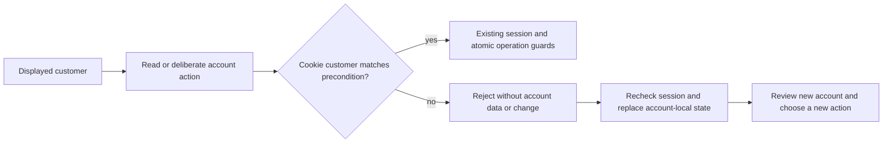
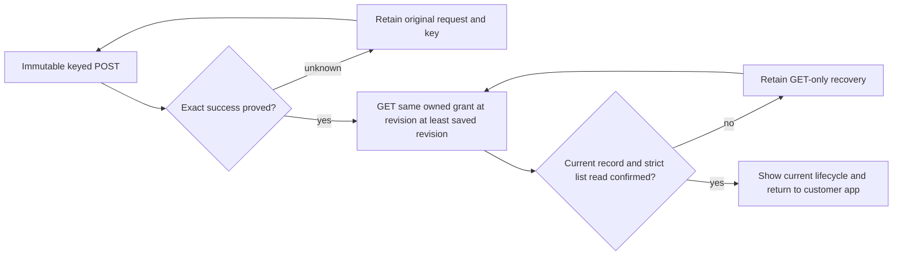

# Confirmed workflow issues and fundamental corrections

Date: 2026-10-25. Review baseline:
`29cca0b3ad09efe46355f9bb5e4c817814b5ae92` on
`fix/ui-ux-gap-closure-20261025`.

Verified implementation: `8afe0e72e1f66990d953f1ae1b37abc1d6fdde78`.
All five findings are closed. The validated candidate was committed without
changing any of its 59 classified files; the worktree was clean at that ref.

The five findings in the preceding
[workflow review](2026-10-25-current-ui-workflow-review.md) were confirmed.
The baseline reproductions used the application code at `b81ec727`, ten
desktop/mobile observations, and a compiled portal Worker with real SQLite
and minted fixture sessions for the account-switch mutation. Their original
evidence remains under `build/workflow-review-20261025-4438e323/`.

## Corrections and invariants

| Finding | Confirmed cause | Correction |
| --- | --- | --- |
| WF1, P2: account actions can target a different signed-in customer | The cookie selected the owner while the UI retained a previously displayed identity. Account routes had no displayed-customer precondition. | One portal-local precondition now covers identity inventory, unlink, password settings and password changes, and native provider linking. Device operations reuse the same comparison. A mismatch exposes no account data and makes no account change; the UI rechecks its session, discards the previous account's local fields and confirmations, and requires a new action. |
| WF2, P2: a successful grant can stay locked after its lifecycle changes | Confirmation compared mutable status to the successful POST snapshot. A pending debounced list read could also invalidate the strict refresh's ticket. Navigation cleared the completion message. | Confirmation separates the immutable write proof from the current record. It retains exact identity, fingerprint, customer and purchase ownership; rejects an older revision and an inconsistent same-revision status; and accepts a later lifecycle revision. A strict list refresh records the filter generation it covers. The guided flow carries its final result to the customer's app, including a neutral message naming the current status. |
| WF3, P3: password completion promises sign-in for reset | A shared opaque-token form assumed every success other than reset authenticated the customer, and its action label promised sign-in. | The action is Save password. Only the documented signed_in result proceeds to session confirmation. password_updated reports the save and asks the customer to sign in. A known saved password with a failed session check offers GET-only Confirm sign-in. An undocumented success never assumes authentication or offers to replay the token. |
| WF4, P3: guided grants lose human customer context | Navigation carried only an ID, and the global grant form displayed only that ID. | The exact customer read that launches the draft supplies one readonly identity tuple: ID, name and email. The draft derives ownership from that tuple's ID and retains its display context through policy detours and partial recovery. Another customer replaces the tuple together. Names and emails stay out of URLs and history.state. |
| WF5, P3: lifecycle actions conflict with status vocabulary | Badges said suspended while customer/access actions and batch progress said Disable/Reenable. | Customer and access workflows consistently use Suspend, Resume and Revoke, including confirmations and batch results. The glossary defines that rule and a scoped source guard enforces it. Configuration controls retain their established wording; wire action/status values remain unchanged. |

The shared portal JSON boundary also checks envelope shape and HTTP success
coherence before reporting success. Header construction preserves Headers
instances, including the new account precondition. Session recovery keeps the
existing epoch fence so a late response from an older account cannot bounce
a newly confirmed session.

### Account boundary



Authentication still comes exclusively from the cookie. Existing exact-origin
checks, recent-authentication requirements, conditional live-session writes,
last-sign-in-method protection, password compare-and-swap and session
revocation remain in place. Rejection never replays an A-account intention
against B.

### Grant boundary



Wrong identity, foreign ownership, inconsistent/stale revision, malformed
data and unavailable reads retain recovery. A later suspension or revocation
does not turn a proven successful write into an unresolved POST. The
customer identity tuple is display context from the opening read; the server
continues to authorize ownership by ID.

## Portal API compatibility and rollout

Identity inventory, unlink, and both password-settings methods now require
`x-expected-customer-id: encodeURIComponent(displayedCustomerId)`. Missing
values return `400 invalid_request`; a session mismatch returns
`409 account_changed`. Native OAuth link forms carry that encoded value in
one hidden `expected_customer_id` field. Missing, duplicate or extra form
fields are refused before OAuth state is created. Sign-in mode stays
independent of a displayed customer.

Requiring a precondition tightens the existing contract. The required-field
compatibility risk is explicit in
[AIP-180](https://google.aip.dev/180). The migration is documented in the
[portal README](../../services/cloudflare-customer-portal/README.md):
deploy Worker and assets together, reload cached Account pages, and update
custom account clients. An optional fallback would retain the wrong-account
mutation. A rollback must retain the server check. Licensing SDK contracts,
route identities, lifecycle wire values and schemas are unchanged. Only the
portal canonical OpenAPI baseline changed; it still describes 29 routes.

Cloudflare's current
[D1 binding documentation](https://developers.cloudflare.com/d1/worker-api/d1-database/)
and [Worker guidance](https://developers.cloudflare.com/workers/best-practices/workers-best-practices/)
were checked. The existing first-primary reads and conditional batch writes
were preserved. Latest Worker type definitions inspected locally were
`@cloudflare/workers-types@5.20261025.1`; repository dependency pins were kept.

## Validation evidence

The required commands used npm `10.9.8` through
`npx --yes npm@10.9.8`, uv `0.12.18` from the existing local toolchain, and
Python `3.12.8` for the deterministic gate. The docs runner explicitly selects
Python 3.13. The environment prefix for commands needing uv was:

```powershell
$env:PATH='C:\Users\HEQ\Projects\licensecc\build\gap-closure-20261011-c5095b8c\uv;'+$env:PATH
$env:UV_PYTHON='3.12'
```

| Exact command | Outcome at the implementation tree |
| --- | --- |
| `npx --yes npm@10.9.8 ci` | Exit 0; 357 packages installed, audit reported zero vulnerabilities. |
| `npx --yes npm@10.9.8 run check:pr` | Exit 0; 1,807 Node tests in 26 blocks, zero failures. Includes lint, type checks, architecture, contracts, service tests, SQL/D1 conformance and schema parity. |
| `npx --yes npm@10.9.8 run setup:browsers` | Exit 0; one root command covering Chromium for both UI workspaces. |
| `node build/workflow-fundamental-fixes-20261025-29cca0b3/run-browser-gate.mjs` | Exit 0; launches the root `npx --yes npm@10.9.8 run test:e2e`: 8 cross-service integration tests, 227 admin browser cases and 150 portal browser cases, all passing. |
| `npx --yes npm@10.9.8 run check:dry-run` | Exit 0; all four Workers built and dry-ran successfully. |
| `npx --yes npm@10.9.8 run check:docs` | Exit 0; fresh Doxygen XML and strict Sphinx HTML build. |
| `node --test scripts/docs-accuracy.test.mjs` | Exit 0; 18 documentation checks after adding this report. |
| `npx --yes npm@10.9.8 run check:architecture`, `node scripts/report-hotspots.mjs --check`, `npx --yes npm@10.9.8 run test:contracts` | Exit 0 after the implementation commit; tracked-source boundaries, hotspot limits and all canonical service contracts confirmed. |
| `git diff --check` | Exit 0. |

Artifacts belong to this task under
`build/workflow-fundamental-fixes-20261025-29cca0b3/`.

Focused regression coverage includes:

- Real compiled Worker/SQLite refusal of missing and switched customer
  preconditions for identity reads, unlink, password reads and changes;
  no credential, identity or session mutation on rejection.
- Native provider forms refusing a switched/missing/duplicate customer,
  creating no OAuth state; normal linking still starts with the matching
  customer. Existing linking, unlink concurrency, last-method, password
  rotation and CAS tests continue to run.
- Browser account switches at 1440 and 390 pixels: old intent is refused,
  identity is refreshed, local fields/confirmation are cleared, and a newly
  reviewed action succeeds for the new account.
- Later suspended/revoked grants completing exactly once with current-state
  feedback; older, empty, wrong-owner and unavailable reads retaining
  GET-only recovery and never creating another purchase or POST.
- Customer name/email surviving policy detours and license-only recovery,
  replacement on customer switch, and absence from URL/history.state.
- Registration's saved-password recovery issuing one POST and subsequent
  session GETs; reset requiring sign-in; undocumented results failing closed.
- Existing destructive confirmations, typed revocations, reason gating,
  idempotency keys, pagination/fences and lifecycle behavior across the full
  browser suite.

Browser previews use fresh isolated builds on ports 44973/44974 and stop
after the gate. Generated trees and local evidence stay uncommitted. All ten
tested UI files were byte-identical to the final service builds
(`browser-asset-proof.json`). All 59 classified candidate files still
matched their recorded hashes before commit (`candidate-manifest.json`).
Ten retained regression screenshots cover both widths; representative
mobile layouts were visually inspected, including the refreshed account,
customer identity during partial recovery, and neutral current-state
confirmation.

## Scope and remaining external validation

This closes the five confirmed findings and the related confirmation-refresh
race. It does not claim a new audit of every product requirement. No
production deployment, live provider authorization or real email delivery
was performed; provider/email integration boundaries use local fixtures.
The native runtime, native install/docs quickstart and SDK implementations
were unchanged, so their dedicated gates were not rerun. The full docs gate
does include Doxygen and strict Sphinx. Maintained source measurements and
the lifecycle glossary were updated; protected plans and preceding evidence
were preserved.
